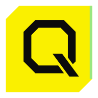

# QADREN — UI/UX Design System

Статус: **обязательная исходная спецификация для реализации SwiftUI**, редакция 2026-10-12. Направление визуального оформления согласовано как «киберпанк-инструментальная панель»; точные значения токенов — первоначальный проверяемый baseline, не утверждение о проведённой визуальной приёмке. Реализация остаётся PARTIAL до тестов и утверждённых снимков.

## Точка входа и приоритет

1. [Визуальный язык и бренд](visual-language.md) + [машиночитаемые токены](tokens.json).
2. [Атомарные и составные компоненты](components.md).
3. [Сетка, реестр и жизненный цикл виджетов](widget-system.md).
4. [Панель мониторинга](monitoring.md) и [панель настройки](settings.md).
5. [Контракт реализации и приёмки](implementation.md).
6. [Статический визуальный прототип](prototype.html) — **демонстрация**, не поведение приложения и не альтернативная спецификация.

В случае расхождения: безопасность из `docs/policies/` и предметные решения `docs/architecture/`/ADR выше внешнего вида. Внутри дизайн-системы поведенческие контракты Markdown имеют приоритет над примером HTML. Реальный текущий `main` проверяется перед кодом; отсутствие функции показывается как недоступность/заглушка, а не «готово».

## Нельзя менять при реализации

- Мониторинг — **полотно интерактивных виджетов без постоянного Sidebar или навигации по разделам**; временный каталог виджетов только в режиме компоновки.
- Два типа рабочих окон уже заданы: мониторинг (несколько независимых окон) и панель настройки. Меню macOS — точка входа и быстрые действия; закрытие UI не равносильно остановке фоновой службы после её реализации.
- Тёмная киберпанк-тема — основной художественный baseline: тёмная глубина, электрический циан/синий, контролируемое свечение; светлая и системная темы также предусмотрены.
- **Использовать только** `assets/qadren-logo.png` как знак QADREN; не создавать «похожий» знак, не заменять SF Symbols логотипом стороннего продукта.
- Запрещены выдуманные графики/числа, подмена UNKNOWN ошибкой/успехом, локальная загрузка содержимого на основной MacBook без разрешения, декорация недоступной функции активной кнопкой.
- Сначала существующий `MainView.swift`, `QADRENApp.swift`, `StorageConnections.swift`, `JobInventory.swift`, `LocalWorkspace.swift`, не второй UI-слой и не второй Rust Job Engine.

## Разделение решений

| Тип | Источник истины |
|---|---|
| Функции синхронизации, локальные загрузки, подтверждения | `docs/architecture/backup-model.md`, `docs/policies/` |
| Состав и взаимодействие UI | файлы `docs/design/*.md` |
| Отступы, палитра, размеры, типографика | `docs/design/tokens.json` + пояснения в `visual-language.md` |
| Существующие API и runtime readiness | `main` исходный код, тесты и issue #18/#22/#23 |
| HTML-демонстрация | только стилистический и композиционный референс |

Не менять принятые документы «по вкусу Codex»; конфликт описать и согласовать. Документация не является разрешением преждевременно активировать опасные команды.

## Рекомендуемый путь для Codex

Прочитать документы в приведённом порядке, инвентаризировать текущие компоненты, создать общий theme/token слой и виджетный chrome, затем перевести текущую панель на виджетную поверхность без изменения доменной логики. После визуального baseline интегрировать реальные read-only данные, потом разрешённые команды через FFI в порядке релизных gates. Каждый инкремент проверять по [implementation.md](implementation.md). Работать в `main`, без новых веток и без отдельного дизайн-репозитория.
